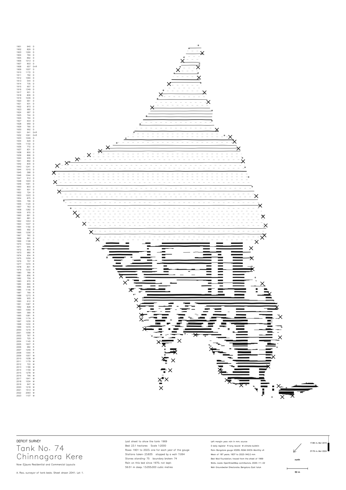

# Anjana Rao

*A government land surveyor in 2041, still sent to measure the irrigation tanks Bengaluru has built over.*

**The press:** https://kala0606.github.io/anjana-rao/ — draw a lot, read a row, or find out whether you are standing on a tank bed.

> **This is a worked example.** It was made for *Computationally Yours: Out of One's Place* (Srishti Manipal Institute, Interim 2026) before Day 1, to show what a finished A1, A2 and A3 can hold. Anjana Rao is the studio's example identity, so her condition is taken. An AI agent (Claude) wrote the text and the code here, which your own project can't do: your manifesto, log and statement are yours. Anything that needs a hand, a machine, a partner or a room is left open and [listed below](#left-open). Nothing has been faked to fill it.

## The work

*Deficit Survey, Tank No. 74* is an A2 black pigment print: a survey sheet of Chinnagara Kere, a 23-hectare irrigation tank in the east of the city, now Ejipura. Each of its 123 rows is a year of rain, 1901 to 2023. The same system makes a sheet for any of 26 lost tanks.

## Manifesto

[manifesto.md](manifesto.md), 150 words. How it changed, and why: [manifesto-versions.md](manifesto-versions.md).

## How the system works

It takes the outline of a lost tank from an old sheet, and lays one row of survey lines across it for every year the city's rain gauge was read. While a sheet proves the tank was there, a row is drawn for the rain that fell short. After the last sheet, it is drawn for all the rain that fell and was not kept, and the lines stop at every building that stands on the bed now. More water missing is more ink. The full account is in [process.md](process.md).

## Parameters

| Parameter | What it controls | Range | Set at | Her reason |
| --- | --- | --- | --- | --- |
| `cell` | Station spacing (m) | 2 to 20 | 4 | The distance between two stations on a chain a person can carry. Nothing is drawn between two stations unless both are clear. |
| `passes` | Pen passes per 100 mm of water | 0.15 to 0.6 | 0.5 | Absence is drawn heavier than presence. More water missing is more ink, counted in whole passes of the pen. |
| `first` | First year | 1837 to 1950 | 1901 | The gauge has been read since 1837. I begin where the daily register begins. |
| `ledger` | Ledger | what the sky withheld / what the city did not keep / both | both | Before the last sheet that shows the tank, a loss is rain that did not fall. After it, a loss is rain that fell and was not kept. |
| `stopped` | Chain stopped by buildings | on / off | on | I can't lay a chain through a wall. The city appears only as the place where measuring had to stop. |
| `stone` | Stones every (m) | 10 to 60 | 25 | My father kept boundary stones. A boundary is not a line, so I draw none. |
| `hand` | Hand (mm) | 0 to 0.3 | 0.08 | A person held the chain. The shake is mine; the length is not. |
| `pen` | Pen (mm) | 0.15 to 0.5 | 0.3 | The pen that was in the box. |
| `tank` | Tank | by lot, or one of 26 | by lot | The lot decides which sheet I pull from the register. It never decides what I find there. |
| `bearing` | Turn of the chain (degrees) | -30 to 30 | 0 | North is the convention of those who own the sheet. I turn the paper to the chain. |

## Run it

Open the press link above. To work on it locally, ask your agent to "preview". The rules are in `src/system.js`; the dials are in `config/params.json`. Any sheet can be made again from its seed: the exhibited one is seed 1 with every dial at its default.

## Three submissions

The repository is tagged at each deadline, so you can see what was in it and what wasn't yet.

- **A1 · Identity** (tag `A1`): identity.md, manifesto version 2, references.md, candidates.md, metaphors.md, proposal.md, card, log to Day 5
- **A2 · System** (tag `A2`): src/, config/, data/, twenty outputs, system.md, diagram, authorship.md, production-plan.md, log to Day 10
- **A3 · Final** (tag `A3`): print files, SPEC.md, process.md, final-statement.md, reflection.md, tests, exhibition proposal, the press, [SUBMISSION.md](SUBMISSION.md)

## Ready to print

| File | What it is | Print at |
| --- | --- | --- |
| [deficit-survey_74_print.pdf](outputs/production/deficit-survey_74_print.pdf) | The exhibited sheet, vector. Send this one first. | A2, 100%, black, matte cotton rag |
| [deficit-survey_74_print_A2_300ppi.tif](outputs/production/deficit-survey_74_print_A2_300ppi.tif) | The same, 4961 × 7016 px, 300 PPI, sRGB embedded | A2, 100% |
| [deficit-survey_74_teststrip_190x120_300ppi.tif](outputs/production/deficit-survey_74_teststrip_190x120_300ppi.tif) | Test strip: finest, lightest and darkest parts at true size | 190 × 120 mm, same paper |
| [deficit-survey_74_plot.svg](outputs/production/deficit-survey_74_plot.svg) | The alternate: A2 pen plot, three pens | 420 × 594 mm |
| [card/identity-card.pdf](card/identity-card.pdf) | Identity card | A6, 100%, card stock |
| [card/label.pdf](card/label.pdf) | Label with QR code | 105 × 50 mm, 100%, matte |
| [card/manifesto-panel.pdf](card/manifesto-panel.pdf) | Manifesto for the wall | A3, 100% |

## Left open

- The print itself, the test strip, the proof, the pen plot, and every photograph of them
- The system diagram by hand (`diagram/system.svg` is the one to copy from)
- The pair interview, peer feedback and the three critiques' notes cards
- The QR code scanned on three phones, and the sixty seconds said aloud
- The Collective Atlas entry's connections, which need the other twelve identities

## Credits

Tank boundaries: Mod Foundation, Bengaluru Watershed. Rain: NOAA GHCN-Monthly v4. Walls and roads: © OpenStreetMap contributors, ODbL. Depth to water: Groundwater Directorate, reported by ThePrint. Letters: A. V. Hershey, 1967, by way of hersheytextjs. Press: the Computationally Yours starter. Details in [data/SOURCES.md](data/SOURCES.md).
